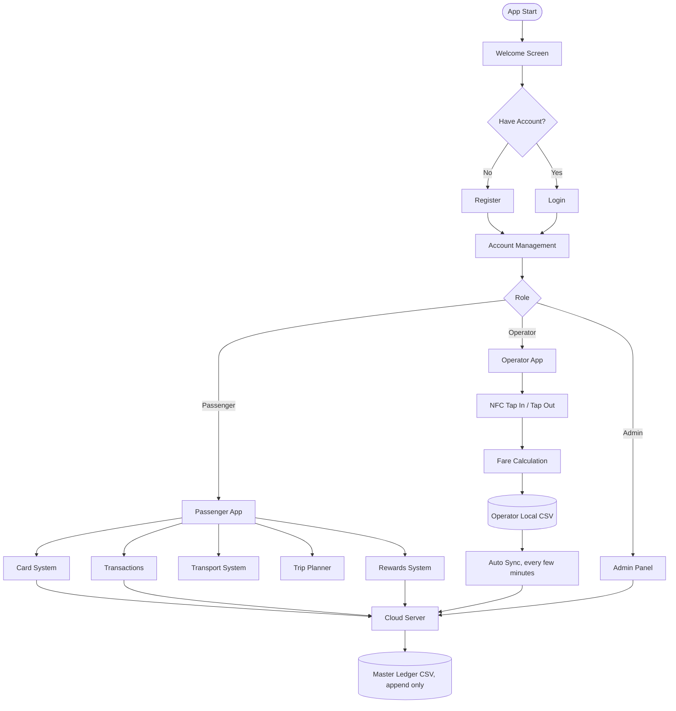

# FareX Master Overview

Whole system, top level. Each box links to its own detail file.

## Modules, one file each

1. [Account Management](01-account-management.md), register, login, role split
2. [Card System](02-card-system.md), xPress Card, load, lost card, link card
3. [Transport System](03-transport-system.md), routes, stations, vehicles, fare formula
4. [Trip Planner](04-trip-planner.md), best route logic
5. [Rewards System](05-rewards-system.md), points, redeem, promotions
6. [Transactions](06-transactions.md), history, sync, dedupe
7. [Passenger App](07-passenger-app.md), full passenger screen map
8. [Operator App](08-operator-app.md), tap device, GPS, local CSV
9. [Admin Panel](09-admin-panel.md), manage users, routes, fares, vehicles, promotions
10. [Server Backend](10-server-backend.md), Javalin service, ledger, sync endpoint

## Rules that hold system wide

- CSV only, no database engine.
- Ledger rows are append only, never edited.
- Every row carries a UUID, server drops duplicate UUIDs on merge, safe to retry upload.
- Card balance is signed by server key on write, tampered card gets rejected on next read.
- One operator account per jeepney.
- Fare = base fare + rate per km, minus 20% if student, senior, or PWD.
- Trip planner shows at most 3 routes, ranked by shortest distance, fewest transfers, cheapest fare.
- Reward points earned per km traveled.
