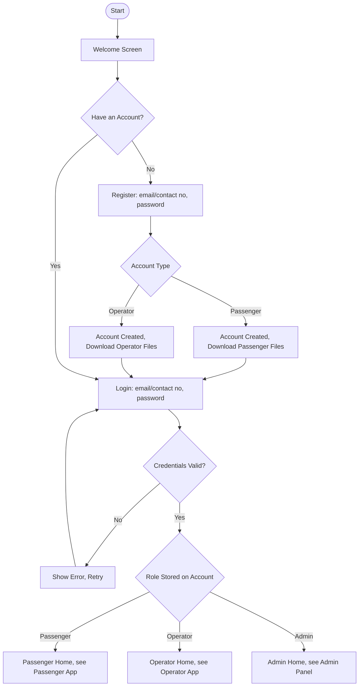

# Account Management

Back to [Master Overview](00-master-overview.md).

## Notes

- Role is fixed at registration, one account cannot switch role later. New role needs a new account.
- "Download Files" means the seed CSV set, station list, fare table, current app version assets, so the app has something to read offline on first run.
- Server is the source of truth for accounts. Registration and login both round trip to the cloud server.
- Admin accounts are created separately by an existing admin, not through the public register screen.

Next: [Passenger App](07-passenger-app.md) or [Operator App](08-operator-app.md) or [Admin Panel](09-admin-panel.md).
