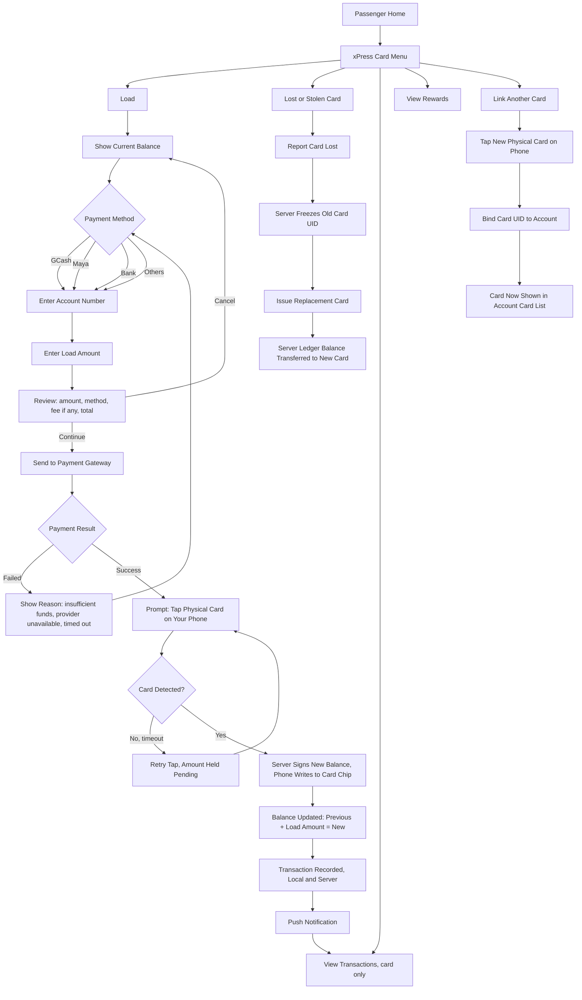

# Card System (xPress Card)

Back to [Master Overview](00-master-overview.md).

## Why balance is held on the card, not just the server

Jeepneys tap in the field, often with weak or no signal. The card itself must carry the true spendable balance so a tap works offline. The server keeps a synced copy of that balance for reporting, rewards math, and lost card recovery, but it can lag behind the card by a few minutes until the operator phone next syncs.

## App shown balance vs card balance

- Passenger app shows last synced balance from server, with a small "as of" timestamp, this can lag.
- If the passenger taps their own card on their own phone, the app reads the exact live balance straight off the chip, no lag.

## Lost card

Old card UID gets frozen server side so it can no longer be spent, even if physically tapped elsewhere. Balance on the frozen card's last synced ledger entry moves to the new card's starting balance.

Next: [Transactions](06-transactions.md), [Rewards System](05-rewards-system.md).
