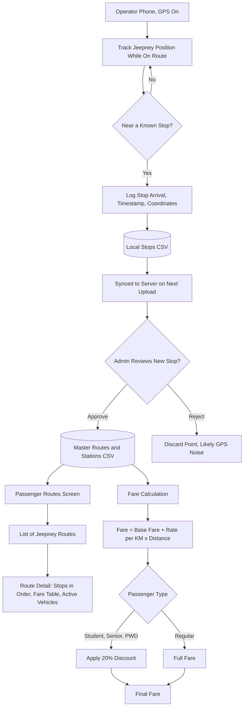

# Transport System

Back to [Master Overview](00-master-overview.md).

## How route data gets built

No manual route drawing screen for now. The operator phone's GPS quietly logs where the jeepney actually stops while driving its normal shift. Those points sync up and admin approves real stops into the master route table. This keeps the map honest to what jeepneys actually do, and filters GPS jitter before it pollutes the real data.

## Fare calculation, used by Card System and Trip Planner both

Distance is measured between tap in stop and tap out stop, using coordinates from the route data, not straight line air distance. Discount type is set on the passenger's account profile ahead of time, ID verified once at registration or by admin.

Next: [Trip Planner](04-trip-planner.md), [Card System](02-card-system.md).
