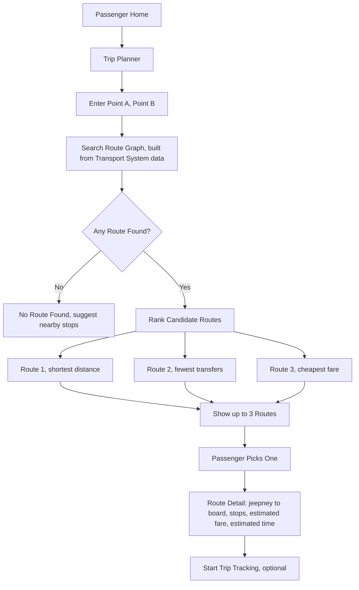

# Trip Planner

Back to [Master Overview](00-master-overview.md).

## Ranking logic

Route graph nodes are stops, edges are jeepney legs pulled from the Transport System's route table. Each edge carries distance and fare (base fare + rate per km, minus discount if applicable).

- Shortest distance, sum edge distances, pick lowest.
- Fewest transfers, count number of jeepney changes, pick lowest.
- Cheapest fare, sum edge fares, pick lowest.

If two candidates tie on the criterion, break the tie with total distance. Duplicate routes across criteria collapse into one card, so passenger never sees the same route listed twice even if it wins on more than one criterion.

Next: [Transport System](03-transport-system.md).
