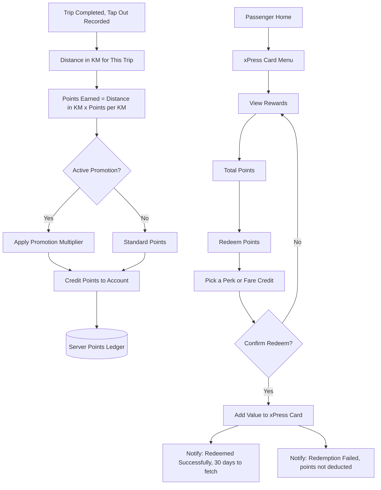

# Rewards System

Back to [Master Overview](00-master-overview.md).

## Notes

- Points accrue automatically on every completed trip, no manual claim step.
- Promotions can multiply the point rate for a limited window, admin controlled, see [Admin Panel](09-admin-panel.md).
- Redeemed value is written to the card the same way a load is, so it goes through the same signed NFC write step described in [Card System](02-card-system.md).
- "30 days to fetch" means redeemed points convert to a card credit that must be picked up, by tapping the card, within 30 days or it expires.

Next: [Card System](02-card-system.md), [Transactions](06-transactions.md).
