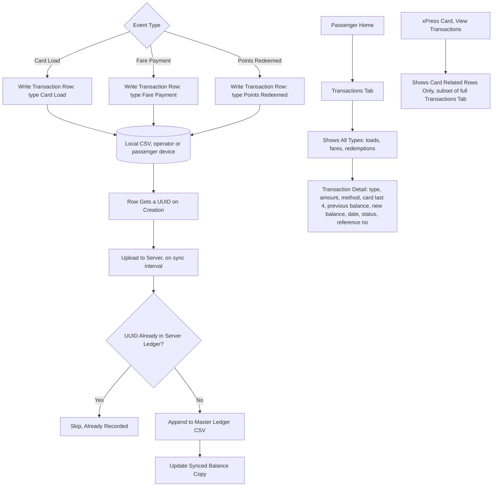

# Transactions

Back to [Master Overview](00-master-overview.md).

## Two transaction views, not a duplicate

- Home "Transactions" tab, everything: card loads, fare taps, reward redemptions.
- xPress Card "View Transactions", filtered to just that card's activity, a narrower view of the same ledger.

## Why append only plus UUID

Operator phones can lose signal mid upload and retry the same batch. Since every row is stamped with a UUID at creation time, retried uploads just get skipped as duplicates on the server side, so nothing double counts and no row ever needs editing after the fact.

Next: [Card System](02-card-system.md), [Server Backend](10-server-backend.md).
