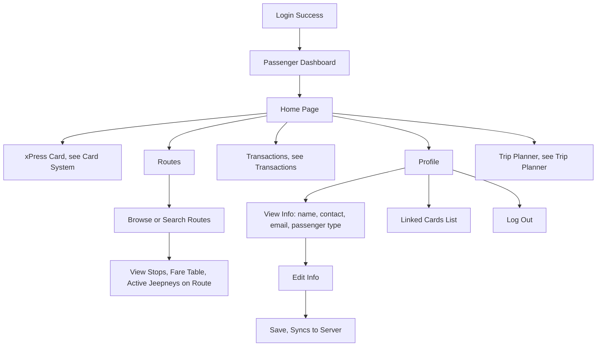

# Passenger App

Back to [Master Overview](00-master-overview.md).

## Screen map

| Screen | Feeds into |
|---|---|
| xPress Card | [Card System](02-card-system.md) |
| Routes | [Transport System](03-transport-system.md) |
| Trip Planner | [Trip Planner](04-trip-planner.md) |
| Transactions | [Transactions](06-transactions.md) |
| Profile | Account Management data, editable subset |

Profile shows passenger type (regular, student, senior, PWD), this is what the fare engine reads for the 20% discount check.

Next: [Card System](02-card-system.md).
