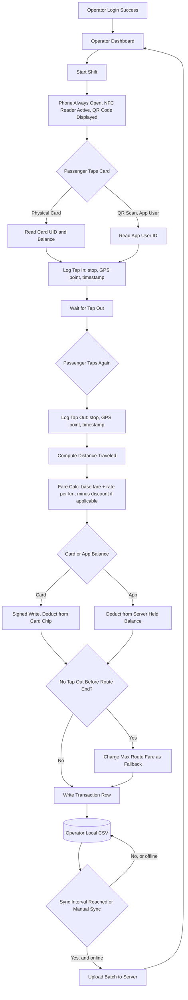

# Operator App

Back to [Master Overview](00-master-overview.md).

## Notes

- One operator account per jeepney, login happens once at shift start, not per passenger.
- Tap in without a matching tap out, common if a passenger forgets, gets charged the max fare for that route as a fallback so the operator is never shorted.
- GPS points logged at tap in and tap out double as the raw feed for [Transport System](03-transport-system.md) stop detection.
- Sync retries safely because every row already carries a UUID, see [Transactions](06-transactions.md).

Next: [Transport System](03-transport-system.md), [Server Backend](10-server-backend.md).
