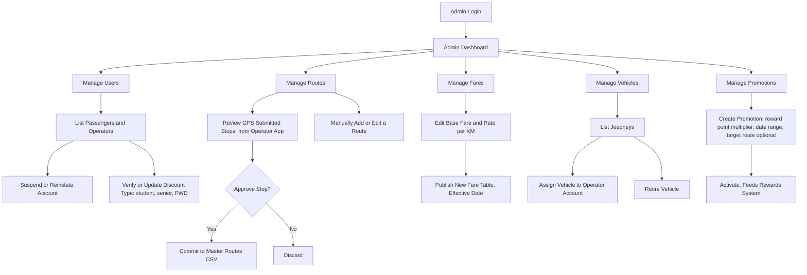

# Admin Panel

Back to [Master Overview](00-master-overview.md).

## Notes

- Fare and route changes publish with an effective date, so operators already mid shift keep the old fare table until the next sync picks up the new one, no fare change mid trip.
- Manage Users is also where the 20% discount flag gets verified, ties into [Transport System](03-transport-system.md) fare calc.
- Manage Promotions feeds straight into [Rewards System](05-rewards-system.md) point multipliers.

Next: [Server Backend](10-server-backend.md).
