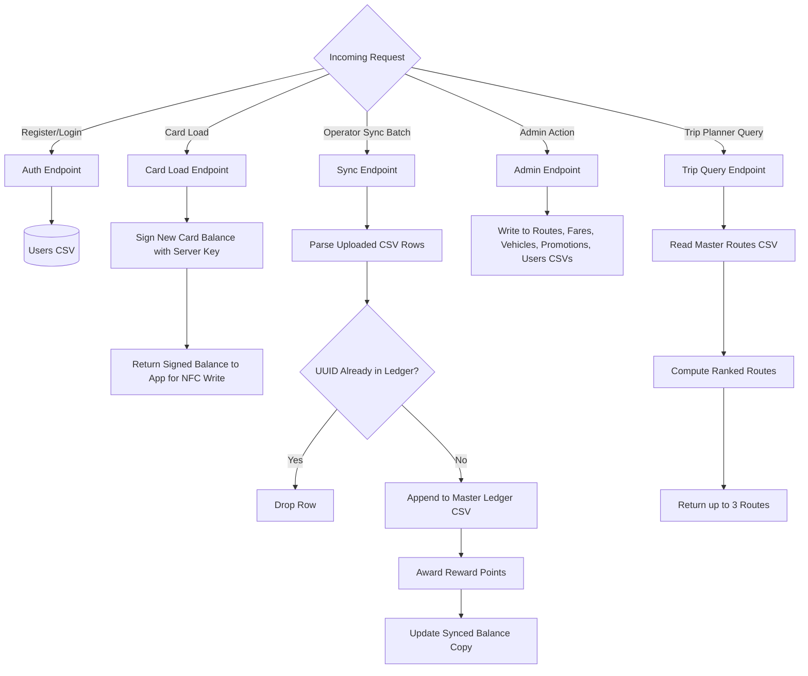

# Server Backend

Back to [Master Overview](00-master-overview.md).

Recommended stack: **Javalin**, plain Java, no heavy framework tax, still gives simple routing over plain HttpServer.

## Data files on the server, all CSV

- `users.csv`, accounts, role, discount type, linked card UIDs.
- `cards.csv`, card UID, last synced balance, status, active or frozen.
- `ledger.csv`, append only, every transaction row, UUID keyed.
- `routes.csv`, `stops.csv`, `vehicles.csv`, transport data.
- `fares.csv`, versioned by effective date.
- `promotions.csv`, active point multipliers.
- `rewards.csv`, points balance and redemption history per account.

## Why signing matters

The server holds the private signing key. Every balance written to a physical card is signed at write time. On a later tap, if the signature does not match, the card is treated as tampered and rejected, this is what makes it safe to trust a balance stored offline on the card chip.

Next: [Card System](02-card-system.md), [Transactions](06-transactions.md), [Admin Panel](09-admin-panel.md).
